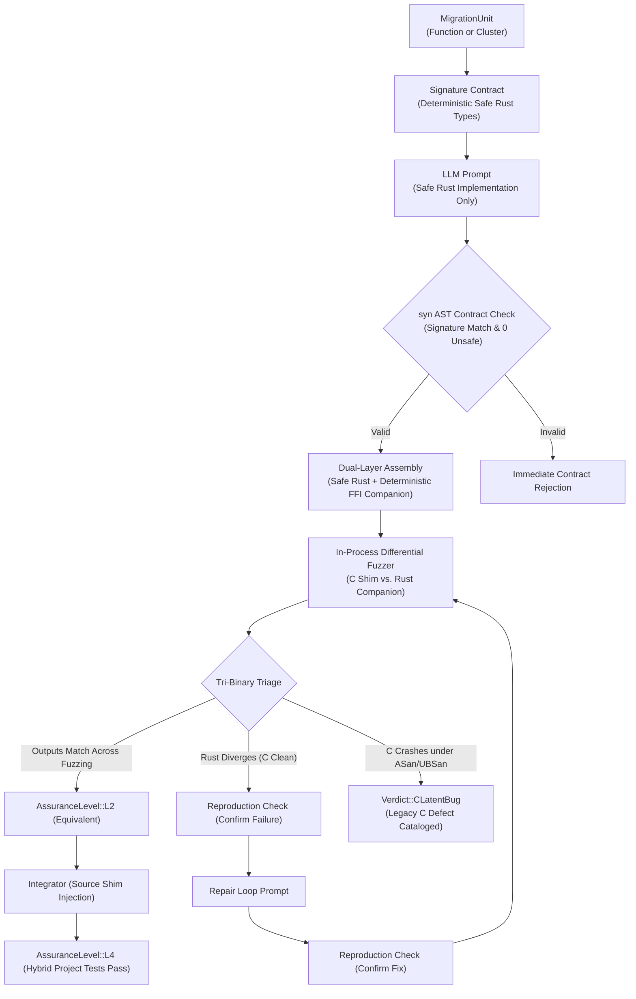

# Ferrite Domain Context & AI Agent Operational Guide

Ferrite is an automated, model-agnostic C-to-Rust migration agent that operates under a strict governing principle: **The LLM proposes; a deterministic verification engine disposes.**

This document provides the authoritative domain vocabulary, architectural invariants, and operational decision boundaries required by AI agents and agent-driven developers working on or with the Ferrite codebase.

---

## 1. Core Domain Terms

| Term | Precise Definition | Avoid in this Context | Evidence / Source |
|---|---|---|---|
| **MigrationUnit** | The atomic entity of planning, translation, and verification. Contains one C function (for pure code) or a cohesive cluster of functions sharing internal state or structs. | `FunctionUnit`, `Task`, `WorkItem` | [`src/models.rs`](file:///C:/Users/danie/.gemini/antigravity/worktrees/ferrite/add_architecture_decision_records/src/models.rs), [`docs/ARCHITECTURE.md`](file:///C:/Users/danie/.gemini/antigravity/worktrees/ferrite/add_architecture_decision_records/docs/ARCHITECTURE.md#L43-L50) |
| **Dual-Layer Translation** | The architecture where the LLM produces strictly memory-safe, idiomatic Rust, accompanied by a deterministically generated `extern "C"` FFI companion wrapper bridging C callers. | `Direct translation`, `C-style Rust`, `Transpilation` | [ADR-0004](file:///C:/Users/danie/.gemini/antigravity/worktrees/ferrite/add_architecture_decision_records/docs/adr/0004-dual-layer-translation-with-template-ffi.md), [`src/translate.rs`](file:///C:/Users/danie/.gemini/antigravity/worktrees/ferrite/add_architecture_decision_records/src/translate.rs) |
| **Signature Contract** | The deterministic Rust function signature synthesized by the analyzer/planner and passed into the model prompt; validated against model output using `syn` prior to compilation. | `Function spec`, `Type guess`, `Header translation` | [ADR-0007](file:///C:/Users/danie/.gemini/antigravity/worktrees/ferrite/add_architecture_decision_records/docs/adr/0007-phase1-signature-scope.md), [ADR-0010](file:///C:/Users/danie/.gemini/antigravity/worktrees/ferrite/add_architecture_decision_records/docs/adr/0010-fenced-code-contract-syn-validation.md), [`src/translate.rs`](file:///C:/Users/danie/.gemini/antigravity/worktrees/ferrite/add_architecture_decision_records/src/translate.rs) |
| **Tri-Binary Triage** | The verification strategy compiling three distinct binaries (C-only, Rust-only, and unified differential) to isolate whether a failure is a translation divergence, a Rust bug, or a latent bug in the original C. | `ASan run`, `Crash analysis`, `Differential test` | [ADR-0003](file:///C:/Users/danie/.gemini/antigravity/worktrees/ferrite/add_architecture_decision_records/docs/adr/0003-tri-binary-differential-triage.md), [`src/verify.rs`](file:///C:/Users/danie/.gemini/antigravity/worktrees/ferrite/add_architecture_decision_records/src/verify.rs) |
| **C Latent Bug (`CLatentBug`)** | A pre-existing memory-safety defect or undefined behavior in the legacy C code triggered during differential testing under ASan/UBSan, where the candidate Rust code handles the input safely. | `False positive`, `Divergence`, `C bug` | [ADR-0003](file:///C:/Users/danie/.gemini/antigravity/worktrees/ferrite/add_architecture_decision_records/docs/adr/0003-tri-binary-differential-triage.md), [`docs/VERIFICATION_ENGINE.md`](file:///C:/Users/danie/.gemini/antigravity/worktrees/ferrite/add_architecture_decision_records/docs/VERIFICATION_ENGINE.md#L135-L155) |
| **Reproduction Check** | The verification step executing a synthesized standalone test before sending it to the repair prompt (confirming failure) and immediately after repair (confirming fix before full differential re-fuzzing). | `Sanity check`, `Dry run`, `Smoke test` | [ADR-0008](file:///C:/Users/danie/.gemini/antigravity/worktrees/ferrite/add_architecture_decision_records/docs/adr/0008-reproduction-check-repair-loop.md), [`src/verify.rs`](file:///C:/Users/danie/.gemini/antigravity/worktrees/ferrite/add_architecture_decision_records/src/verify.rs) |
| **Source Shim** | A transformed C function body delegating execution directly to the exported Rust companion symbol (`ferrite_<name>`), preserving the target project's build hierarchy. | `Wrapper`, `Stub`, `Trampoline` | [ADR-0005](file:///C:/Users/danie/.gemini/antigravity/worktrees/ferrite/add_architecture_decision_records/docs/adr/0005-source-shim-injection-for-hybrid-builds.md), [`src/integrate.rs`](file:///C:/Users/danie/.gemini/antigravity/worktrees/ferrite/add_architecture_decision_records/src/integrate.rs) |
| **Clang AST Dump** | The JSON representation of the C AST extracted via `clang -Xclang -ast-dump=json` and filtered to translation-unit-local nodes, supplemented by `clang -E -dM` for macros. | `Tree-sitter tree`, `libclang binding` | [ADR-0002](file:///C:/Users/danie/.gemini/antigravity/worktrees/ferrite/add_architecture_decision_records/docs/adr/0002-clang-ast-dump-json-for-analysis.md), [`src/analyze.rs`](file:///C:/Users/danie/.gemini/antigravity/worktrees/ferrite/add_architecture_decision_records/src/analyze.rs) |
| **Assurance Level** | The discrete verification tier reached by a MigrationUnit (L0: compiles/clippy, L1: unit tests pass, L2: differential fuzzing clean, L3: stateful API sequence fuzzing clean, L4: original C test suite passes). | `Confidence score`, `Test grade`, `Safety level` | [`docs/ARCHITECTURE.md`](file:///C:/Users/danie/.gemini/antigravity/worktrees/ferrite/add_architecture_decision_records/docs/ARCHITECTURE.md#L87-L96), [`src/models.rs`](file:///C:/Users/danie/.gemini/antigravity/worktrees/ferrite/add_architecture_decision_records/src/models.rs) |
| **Replay Mode** | Deterministic offline execution mode serving reference Rust translations from `fixtures/replay/<fn_name>.rs.md` without network calls or LLM API usage. | `Mock mode`, `Dry run`, `Dummy run` | [ADR-0011](file:///C:/Users/danie/.gemini/antigravity/worktrees/ferrite/add_architecture_decision_records/docs/adr/0011-replay-provider-and-offline-first.md), [`src/provider.rs`](file:///C:/Users/danie/.gemini/antigravity/worktrees/ferrite/add_architecture_decision_records/src/provider.rs) |

---

## 2. Concept Relationships

- **`MigrationUnit` and `Cluster`**: A `MigrationUnit` encapsulates either an independent leaf function or a `Cluster` of tightly-coupled functions that share private structs, static ring buffers, or internal state.
- **Safe Rust Core vs. Companion FFI**: The safe Rust function operates exclusively on safe types (`&[u8]`, `Result<T, E>`). The companion wrapper (`ferrite_<name>`) bridges C-ABI callers and is shared between the differential fuzz harness (L2) and the final hybrid integration library (L4).
- **Differential Fuzzing vs. Tri-Binary Triage**: Differential fuzzing executes the unified binary at high throughput. When an anomaly occurs, Tri-Binary Triage dispatches isolated C-only and Rust-only binaries to determine fault provenance.
- **Reproduction Check vs. Fuzz Campaign**: Fuzzing is expensive and broad; reproduction checks are instantaneous and pinpointed. A counterexample is always isolated into a standalone unit test before LLM repair, and the fix is verified against that test before resuming full fuzzing.

---

## 3. Resolved Ambiguities

- **"C Bug" vs. "Divergence"**:
  - When differential testing detects an execution divergence, it is **not** automatically assumed to be a Rust translation bug.
  - If the standalone C binary triggers an AddressSanitizer or UndefinedBehaviorSanitizer violation on the test input while the Rust translation executes safely, the outcome is officially classified as `Verdict::CLatentBug`. The Rust translation is deemed verified against that defect, and a CWE security finding is archived.
- **"Replay Mode" vs. "Live Generation"**:
  - `ReplayProvider` reads human-authored reference Rust translations from `fixtures/replay/` to permit 100% deterministic, offline verification and CI without API keys.
  - Replay Mode executes **100% real verification, compilation, fuzzing, and triage**. Only the LLM text completion step is replayed. All documentation and CLI banners must maintain strict transparency on this distinction (ADR-0011).
- **"Equivalence"**:
  - Equivalence is never established by LLM self-assessment or static code similarity. It is defined strictly by empirical survival across $\ge 10,000$ differential fuzz iterations without discrepancies, achieving coverage plateau, and passing native project test suites.

---

## 4. Needs Confirmation (Future Scope)

- **Phase 2 Struct Layouts**: Non-trivial C structs containing nested pointers, unions, or self-referential linked lists are deferred to Phase 2; marked as `needs confirmation` until memory layout marshaling rules are settled.
- **L5 Formal Bounded Equivalence**: Integration with symbolic execution engines (Kani / KLEE) remains exploratory and requires domain owner sign-off on toolchain performance constraints.

---

## 5. Architectural Invariants for AI Agents

When authoring code, refactoring modules, or configuring prompts for Ferrite, AI agents **must strictly adhere** to these non-negotiable invariants:

### Invariant 1: The LLM Proposes, Deterministic Verification Disposes
- Never allow a language model to grade, evaluate, or approve its own translation.
- Equivalence verdicts (`Equivalent`, `CLatentBug`, `Diverged`) must originate solely from the execution exit codes and sanitizer backtraces of compiled binaries in `src/verify.rs`.

### Invariant 2: Safe by Construction (Zero Unapproved `unsafe`)
- The translator prompt explicitly forbids `unsafe` code.
- Pre-compilation validation using `syn` inspects the AST; if an unapproved `unsafe` block or keyword is present, the translation is rejected immediately without invoking `rustc`.
- Unsafe code is confined strictly to deterministically generated companion FFI wrappers (`ferrite_<name>`).

### Invariant 3: Tri-Binary Triage Integrity
- An agent modifying the verification pipeline must never discard or silence AddressSanitizer/UBSan crashes in the C binary.
- If C crashes under ASan/UBSan while Rust returns cleanly or safely panics, classify as `Verdict::CLatentBug`, record the CWE identifier, and archive the backtrace.

### Invariant 4: Two-Phase Counterexample Confirmation
- When handling translation divergences, never send unconfirmed raw errors to the repair prompt.
- Always execute Phase 1 reproduction check: compile and run a synthesized standalone test. If it does not reproduce, the harness is flawed.
- Always execute Phase 2 post-repair check: verify the repair resolves the failing input before initiating a full fuzz campaign.

### Invariant 5: Clean Working Directory Isolation
- All temporary compilation artifacts, intermediate C shims, harnesses, and fuzzer inputs must reside in dedicated directories under `ferrite-out/<fn_name>/`.
- Source modifications made to the target C repository during Stage 6 (L4 integration) must be backed up atomically (`.orig`) and restored upon test completion or abnormal termination.

### Invariant 6: Single-Threaded Verification Execution
- While asynchronous LLM provider requests may run concurrently, heavy compilation (`rustc`, `clang`) and differential fuzzing jobs must be executed sequentially to respect the 5 GB RAM / 4 GB swap resource ceiling and prevent host OOM kills.

---

## 6. Architecture & ADR Quick Reference

For deeper design rationales, refer directly to the authoritative Architecture Decision Records:

- **Runtime & Distribution**:
  - [ADR-0001: Pure Rust Core Orchestrator with Offline Python Analysis](file:///C:/Users/danie/.gemini/antigravity/worktrees/ferrite/add_architecture_decision_records/docs/adr/0001-pure-rust-orchestrator-with-offline-python.md)
  - [ADR-0006: WSL2 Linux Runtime and Single-Threaded Verification Execution](file:///C:/Users/danie/.gemini/antigravity/worktrees/ferrite/add_architecture_decision_records/docs/adr/0006-wsl2-runtime-and-single-threaded-verification.md)
  - [ADR-0011: Replay Provider and Offline-First Verification Architecture](file:///C:/Users/danie/.gemini/antigravity/worktrees/ferrite/add_architecture_decision_records/docs/adr/0011-replay-provider-and-offline-first.md)
- **Analysis & Contracts**:
  - [ADR-0002: Clang JSON AST Dump for C Semantic Analysis](file:///C:/Users/danie/.gemini/antigravity/worktrees/ferrite/add_architecture_decision_records/docs/adr/0002-clang-ast-dump-json-for-analysis.md)
  - [ADR-0007: Phase 1 Signature Scope: Primitives, Slices, Strings, and Out-Pointers](file:///C:/Users/danie/.gemini/antigravity/worktrees/ferrite/add_architecture_decision_records/docs/adr/0007-phase1-signature-scope.md)
  - [ADR-0009: Project Manifest Schema (`ferrite.toml`)](file:///C:/Users/danie/.gemini/antigravity/worktrees/ferrite/add_architecture_decision_records/docs/adr/0009-ferrite-toml-manifest-schema.md)
  - [ADR-0010: Fenced Markdown Code Block Contract with AST Signature Enforcement](file:///C:/Users/danie/.gemini/antigravity/worktrees/ferrite/add_architecture_decision_records/docs/adr/0010-fenced-code-contract-syn-validation.md)
- **Verification, Repair & Integration**:
  - [ADR-0003: Tri-Binary In-Process Differential Fuzzing in Linux Environment](file:///C:/Users/danie/.gemini/antigravity/worktrees/ferrite/add_architecture_decision_records/docs/adr/0003-tri-binary-differential-triage.md)
  - [ADR-0004: Dual-Layer Translation with Deterministic FFI Generation](file:///C:/Users/danie/.gemini/antigravity/worktrees/ferrite/add_architecture_decision_records/docs/adr/0004-dual-layer-translation-with-template-ffi.md)
  - [ADR-0005: Source-Level Shim Injection with Per-Library `ferrite.toml` Configuration](file:///C:/Users/danie/.gemini/antigravity/worktrees/ferrite/add_architecture_decision_records/docs/adr/0005-source-shim-injection-for-hybrid-builds.md)
  - [ADR-0008: Two-Phase Reproduction Check for Counterexample Repair](file:///C:/Users/danie/.gemini/antigravity/worktrees/ferrite/add_architecture_decision_records/docs/adr/0008-reproduction-check-repair-loop.md)
