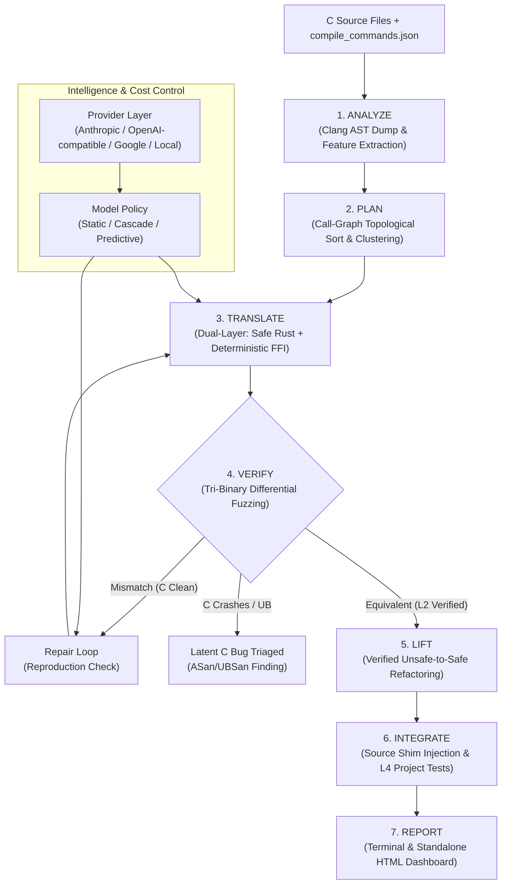
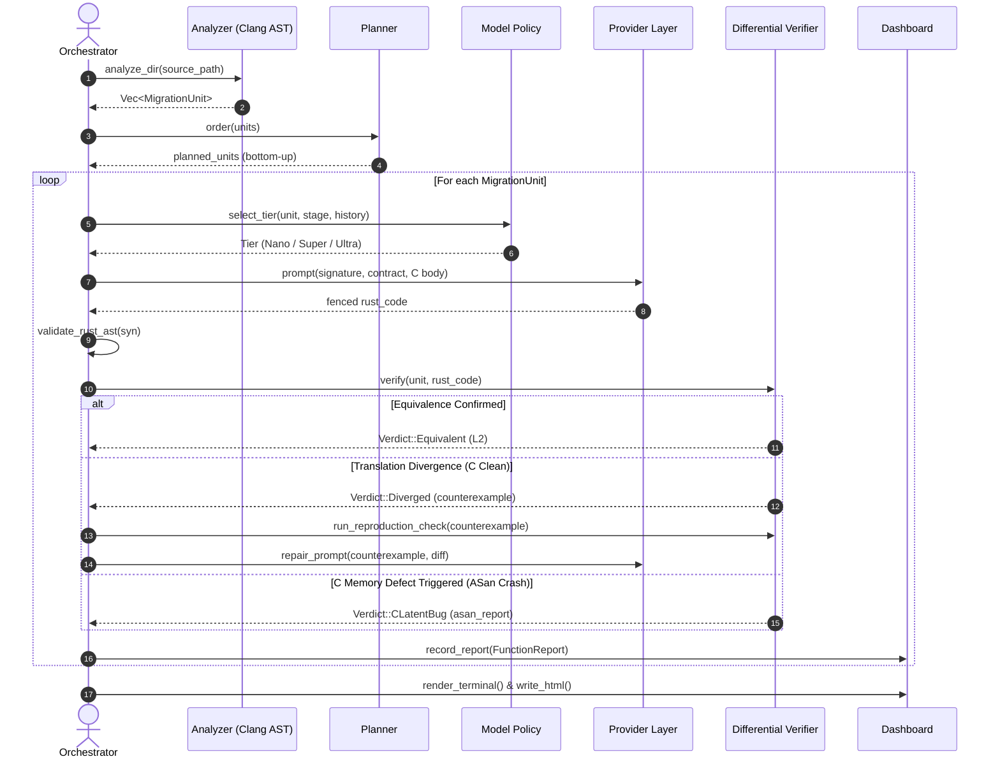

# Ferrite System Architecture

Ferrite is an automated, model-agnostic C-to-Rust migration agent that operates under a strict principle: **The LLM proposes; a deterministic verification engine disposes.**

Every claim of correctness or equivalence is backed by execution under differential fuzzing, compiler sanitizers, and integration test suites—never by LLM self-evaluation.

---

## 1. High-Level Architecture

The Ferrite pipeline processes C codebases function-by-function (or cluster-by-cluster) along a 7-stage deterministic pipeline.



---

## 2. The 7 Pipeline Stages

### Stage 1: Analyze (`src/analyze.rs`)
- **Inputs**: C source files, include headers, and optional `compile_commands.json`.
- **Mechanism (ADR 0002)**: Invokes `clang -Xclang -ast-dump=json` filtered to translation-unit-local nodes, supplemented by `clang -E -dM` for macro expansion.
- **Feature Extraction**: Extracts a compact `FeatureVector` for each function:
  - Pointer arithmetic operations, dynamic memory (`malloc`/`free`) counts.
  - Buffer-length pairs, structs, unions, bitfields, function pointers, varargs.
  - Control flow complexity (loops, recursion, cyclomatic depth).
- **Output**: Set of `MigrationUnit` instances with declared C signatures and deterministically formulated Rust signature contracts (ADR 0007).

### Stage 2: Plan (`src/plan.rs`)
- **Topological Ordering**: Computes a bottom-up call graph. Leaf functions (dependencies) are prioritized and translated first, ensuring callee Rust contracts are available when translating callers.
- **Clustering**: Groups functions that share private structs or internal state into composite `MigrationUnit` clusters.
- **Contract Formulation**: Defines strict parameter mappings (e.g., `(int *arr, int len)` $\rightarrow$ `&[i32]` or `&mut [i32]`, scalar out-pointers $\rightarrow$ `Result<T, E>` or tuple returns).

### Stage 3: Translate (`src/translate.rs`, `src/provider.rs`)
- **Dual-Layer Architecture (ADR 0004)**:
  1. **Idiomatic Safe Rust**: The model generates memory-safe, idiomatic Rust with 0 `unsafe` blocks.
  2. **Deterministic FFI Companion**: Ferrite automatically templates an `extern "C"` wrapper (`ferrite_<name>`) that translates C-ABI pointers and lengths into safe Rust types and back.
- **Provider Abstraction (ADR 0001, ADR 0011)**:
  - **`ReplayProvider` (Default / Offline)**: Loads human-written reference translations from `fixtures/replay/<fn_name>.rs.md`. Enables deterministic zero-API-cost benchmarking, test automation, and offline video demos.
  - **`MockProvider`**: Built-in canned responses for unit tests and vertical slice development.
  - **`OpenAiCompatProvider`**: Connects to remote or local HTTP completions endpoints (e.g. Ollama, vLLM, Nebius Token Factory) with token usage tracking, latency recording, and budget caps.
- **AST Contract Enforcement (ADR 0010)**:
  - Models return a single fenced ````rust```` code block.
  - The AST is validated using `syn` before any compilation attempt to verify:
    - The declared function name and signature strictly match the planned contract.
    - An audit count of `unsafe` blocks is performed.
- **Idiom Memory**: Verified translation pairs are cached and indexed as few-shot exemplars for similar downstream functions.

### Stage 4: Verify (`src/verify.rs`)
The deterministic core of Ferrite. No translation is accepted without passing differential execution.
- **Gate 1**: Strict `rustc` compilation and `clippy` validation (L0).
- **Gate 2**: Template-based harness generation linking C shim and Rust translation in-process.
- **Gate 3**: Tri-Binary triage (ADR 0003) under AddressSanitizer (ASan) and UndefinedBehaviorSanitizer (UBSan).
- **Gate 4**: Two-phase reproduction check (ADR 0008) before and after model repairs.

### Stage 5: Lift (`src/models.rs`)
- Verified refactoring loop that progressively eliminates raw pointers, unbounded indices, or remaining `unsafe` blocks.
- **Invariant**: Each lifting step must re-pass L2 differential fuzzing before being committed. Any regression aborts the lift and retains the verified predecessor.

### Stage 6: Integrate (`src/integrate.rs`, ADR 0005)
- **Source-Level Shim Injection**:
  - In the original C codebase, the target C function body is replaced with an injection shim that forwards arguments to the exported `ferrite_<name>` companion symbol.
- **Hybrid Library Orchestration (`Integrator`)**:
  - Compiles the translated Rust code into a static archive (`libferrite_<name>.a`).
  - Synthesizes `ferrite_shims.c` delegating callers to the Rust implementation.
  - Links both into a unified hybrid library using the configuration in `ferrite.toml` (ADR 0009).
- **L4 Test Suite Verification**:
  - Executes the target project's original test suite (e.g. `test_checksum.c`) against the hybrid binary.
  - Successfully running existing test vectors promotes functions to **`AssuranceLevel::L4`**.

### Stage 7: Report (`src/dashboard.rs`)
- **Terminal Summary**: Concise ANSI-colored terminal overview of assurance tiers, execution counts, coverage percentages, and triage outcomes.
- **Standalone HTML Dashboard**: Self-contained single-file HTML report featuring:
  - Interactive status badges per `MigrationUnit` (L0 to L4).
  - Differential fuzz execution tallies and coverage progress.
  - Sanitizer backtraces for triaged latent C bugs.
  - Side-by-side C source vs. Rust contract view.

---

## 3. Data Flow & Sequence

The following sequence illustrates the verification and triage loop for each `MigrationUnit`:



---

## 4. Subsystem Components

| Module | Primary Responsibility | Associated ADRs |
| :--- | :--- | :--- |
| [`src/models.rs`](file:///c:/Users/danie/Documents/competition%20code/ferrite/src/models.rs) | Domain entities (`MigrationUnit`, `Verdict`, `AssuranceLevel`, `LibraryConfig`) | ADR 0007, ADR 0009 |
| [`src/analyze.rs`](file:///c:/Users/danie/Documents/competition%20code/ferrite/src/analyze.rs) | C lexical/AST analysis, function extraction, feature calculation | ADR 0002, ADR 0007 |
| [`src/plan.rs`](file:///c:/Users/danie/Documents/competition%20code/ferrite/src/plan.rs) | Bottom-up topological scheduling based on call-graph dependencies | ADR 0007 |
| [`src/translate.rs`](file:///c:/Users/danie/Documents/competition%20code/ferrite/src/translate.rs) | Dual-layer generation, prompt assembly, and `syn` AST contract validation | ADR 0004, ADR 0010 |
| [`src/provider.rs`](file:///c:/Users/danie/Documents/competition%20code/ferrite/src/provider.rs) | Model provider abstraction: `ReplayProvider`, `MockProvider`, and `OpenAiCompatProvider` | ADR 0001, ADR 0011 |
| [`src/verify.rs`](file:///c:/Users/danie/Documents/competition%20code/ferrite/src/verify.rs) | Harness generation, clang/rustc compilation, differential fuzz campaign, triage | ADR 0003, ADR 0006, ADR 0008 |
| [`src/verify/stateful.rs`](file:///c:/Users/danie/Documents/competition%20code/ferrite/src/verify/stateful.rs) | Stateful API sequence fuzzing on opaque handles (L3 assurance verification) | ADR 0003 |
| [`src/integrate.rs`](file:///c:/Users/danie/Documents/competition%20code/ferrite/src/integrate.rs) | Hybrid build orchestration, `ferrite_<name>` source-level shims, and L4 test suite execution | ADR 0005, ADR 0009 |
| [`src/bench.rs`](file:///c:/Users/danie/Documents/competition%20code/ferrite/src/bench.rs) | Ferrite-Bench Lite runner, expectation matching, and ANSI leaderboard generation | ADR 0011 |
| [`src/policy.rs`](file:///c:/Users/danie/Documents/competition%20code/ferrite/src/policy.rs) | Cost-quality routing: `StaticPolicy`, `CascadePolicy`, and `PredictivePolicy` | ADR 0001 |
| [`src/dashboard.rs`](file:///c:/Users/danie/Documents/competition%20code/ferrite/src/dashboard.rs) | Terminal rendering and interactive standalone HTML report generation | ADR 0001 |

---

## 5. Architectural Invariants

1. **Deterministic Authority**: The model never grades itself. Equivalence is declared solely through compiler success, differential fuzzing without mismatch, and test pass rates.
2. **Safe by Construction**: LLMs generate safe Rust code. FFI boundary conversions (`unsafe extern "C"`) are generated by deterministic templates, isolating unsafe surface area.
3. **No Mismatch Ignored**: Any execution deviation between C and Rust triggers automated tri-binary triage to isolate whether the fault is in the translation or latent in the original C.
4. **Isolated Workspaces**: All compilation, fuzzing, and execution happen in isolated working directories (`ferrite-out/<fn_name>`) with resource and timeout boundaries.
