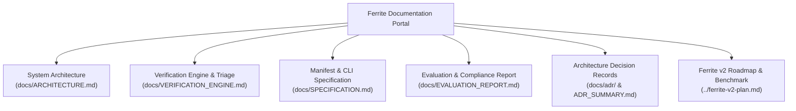

# Ferrite Documentation Portal

Welcome to the technical documentation for **Ferrite: Verified C-to-Rust Migration Agent**.

Ferrite automatically migrates C code to safe, idiomatic Rust one function (or cluster) at a time, accepting translations only after they survive differential fuzzing and sanitizer triage against the original C implementation.

---

## Documentation Roadmap



---

## Core Documents

### 1. [Technical Evaluation & Compliance Report](EVALUATION_REPORT.md)
Comprehensive audit against the 5-point automated verification checklist:
- **30 Verified C-to-Rust Conversions** across scalars, buffers, parsers, and the real `lib_checksum` library.
- **Unsafe Behavior Detection**: Planted C defects (`CWE-125`, `CWE-190`, `CWE-787`, `CWE-476`) and AST-level rejection of unapproved `unsafe` blocks.
- **Differential Fuzzing Results**: 340,408 executions across 34 functions with 100% verdict match.
- **Before/After Behavioral Comparisons**: Concrete side-by-side walkthroughs of C vs. Rust execution under boundary inputs.
- **Documented Limitations**: Transparent disclosure of Replay Mode, Phase 1 signature boundaries, and platform sandboxing.

### 2. [System Architecture](ARCHITECTURE.md)
Detailed walkthrough of the 7-stage migration pipeline:
- **Analyze**: AST dumping (`clang -Xclang -ast-dump=json`) and feature vector extraction.
- **Plan**: Bottom-up topological call-graph ordering and function clustering.
- **Translate**: Dual-layer generation (idiomatic Rust + deterministic FFI companion), provider abstractions (`ReplayProvider`, `MockProvider`, `OpenAiCompatProvider`), and `syn` AST contract validation.
- **Verify**: Differential fuzzing, ASan/UBSan instrumentation, and triage.
- **Lift**: Verified refactoring loop eliminating remaining raw pointers.
- **Integrate**: Source shim delegation (`ferrite_<name>`), static archive linking, and L4 project test execution (`Integrator`).
- **Report**: Terminal summary and standalone HTML dashboards.

### 2. [Verification Engine Deep Dive](VERIFICATION_ENGINE.md)
Comprehensive documentation of the verification engine:
- The **Assurance Ladder** (L0 through L5 criteria).
- **Tri-Binary Differential Triage** (C-only, Rust-only, and unified differential binaries).
- **Harness Generation**: In-process FFI bridge, seed corpus synthesis, and coverage plateau detection.
- **Reproduction Check**: Two-phase confirmation loop before and after LLM repair.
- **Latent C Bug Discovery**: CWE taxonomy (CWE-787, CWE-125, CWE-416, CWE-190, CWE-476) and sanitizer backtrace archiving.
- **Stateful API Fuzzing**: L3 opaque handle sequence fuzzing (`StatefulVerifier`).
- **Hybrid Integration**: L4 test suite execution on migrated C libraries (`lib_checksum`).
- **Ferrite-Bench Lite**: 34-function benchmark suite with 4 planted memory safety defects.

### 3. [Configuration & Specification Guide](SPECIFICATION.md)
Operational specifications for integrating Ferrite into C projects:
- **`ferrite.toml` Manifest Schema**: Build/test commands, include directories, skip lists, and cluster definitions.
- **`manifest.toml` Benchmark Schema**: Multi-tier benchmark definitions and expected verdict mapping.
- **CLI Reference**: Core options (`--provider replay|mock|openai`, `--policy static|cascade`) and the `ferrite bench` subcommand.
- **Environment Variables**: Headless configuration for CI, offline replays, and remote endpoints.
- **Signature Scope**: Supported C-to-Rust signatures in Phase 1 vs. Phase 2 roadmap.
- **Sandboxing & Quotas**: WSL2/Docker runtime constraints and memory limits.

### 4. [Architecture Decision Records (ADRs)](adr/README.md) & [Summary](ADR_SUMMARY.md)
Detailed Nygard-format architectural decision records and their cross-cutting summary with rationale, trade-offs, and consequences:
- **ADR 0001**: Pure Rust Core Orchestrator with Offline Python Analysis
- **ADR 0002**: Clang JSON AST Dump for C Semantic Analysis
- **ADR 0003**: Tri-Binary In-Process Differential Fuzzing in Linux Environment
- **ADR 0004**: Dual-Layer Translation with Deterministic FFI Generation
- **ADR 0005**: Source-Level Shim Injection with Per-Library `ferrite.toml` Configuration
- **ADR 0006**: WSL2 Linux Runtime and Single-Threaded Verification Execution
- **ADR 0007**: Phase 1 Signature Scope: Primitives, Slices, Strings, and Out-Pointers
- **ADR 0008**: Two-Phase Reproduction Check for Counterexample Repair
- **ADR 0009**: Project Manifest Schema (`ferrite.toml`)
- **ADR 0010**: Fenced Markdown Code Block Contract with AST Signature Enforcement
- **ADR 0011**: Replay Provider and Offline-First Verification Architecture

### 5. [Demo & Video Walkthrough Script](DEMO.md)
3–5 minute end-to-end demonstration script covering clean migrations (`L2` & `L4`), divergence detection and repair, surfacing latent C bugs (`CLatentBug`), L3 stateful ring-buffer fuzzing, and switching from Replay Mode to Live Model Mode.

### 6. [Ferrite v2 Strategic Plan & Benchmark](../ferrite-v2-plan.md)
Project vision, competitive positioning, roadmap milestones (M1 through M4), **Ferrite-Bench** design, model routing policies, and evaluation methodology.

---

## Quick Reference: Assurance Ladder

```
[L0] Compiles & Clippy Clean 
  └── [L1] Passes Unit Tests (from examples/docs)
        └── [L2] Differentially Tested (Fuzz campaign against C with coverage plateau)
              └── [L3] Stateful Sequence Tested (Opaque handle lifecycle)
                    └── [L4] Hybrid Integrated (Original C project test suite passes)
                          └── [L5] Formally Bounded (Symbolic execution / Kani)
```
