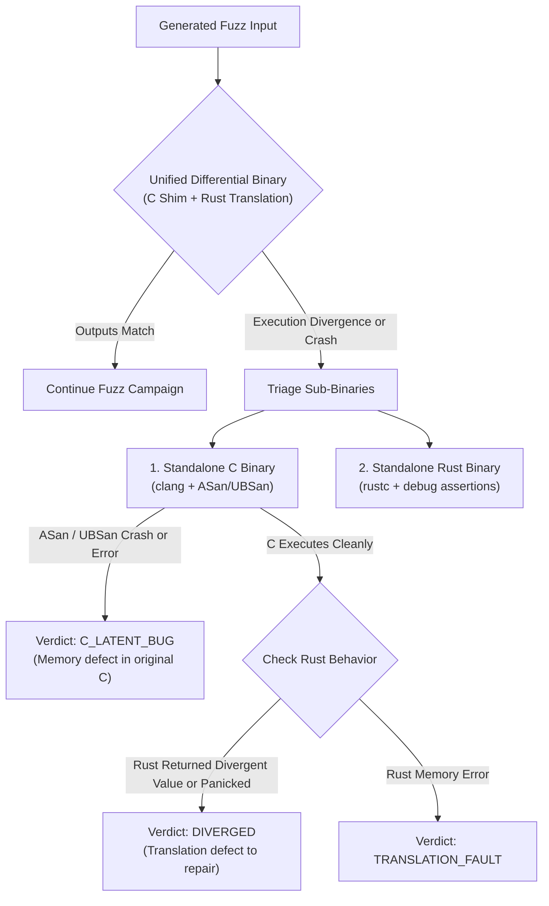

# Ferrite Verification Engine

The **Verification Engine** is the deterministic core of Ferrite. In automated translation, language models often generate syntactically convincing code that contains subtle behavioral regressions, silent precision truncations, or boundary errors.

Ferrite rejects LLM self-evaluation. Equivalence between C and Rust is proven empirically through differential execution under memory sanitizers, structured fuzzing, and regression tests.

---

## 1. The Assurance Ladder

Every migrated function is assigned the highest level it demonstrably attains on the Ferrite Assurance Ladder:

| Level | Name | Verification Method | Exit Criteria |
| :---: | :--- | :--- | :--- |
| **L0** | **Syntactic & Typestate** | `cargo check` and `cargo clippy -- -D warnings` | Compiles without errors; passes strict linter rules; 0 unapproved `unsafe` blocks. |
| **L1** | **Unit Tested** | Unit tests synthesized from existing C tests or doc examples | Passes all standalone unit tests with identical return values for known inputs. |
| **L2** | **Differentially Tested** | In-process differential fuzzing campaign against compiled C | Zero output discrepancies across thousands of random and boundary inputs; coverage plateau reached. |
| **L3** | **Stateful API Tested** | Sequential operation fuzzing on opaque handles | Equivalence verified across sequences of stateful calls (`init` $\rightarrow$ `op` $\rightarrow$ `free`). |
| **L4** | **Hybrid Integrated** | Execution of original C project test suite via source delegation shims | Entire C library test suite passes with translated Rust function dynamically linked. |
| **L5** | **Formally Bounded** | Symbolic execution (KLEE / Kani) or bounded equivalence | Formally verified bounded equivalence for pure computational blocks. |

---

## 2. Tri-Binary Differential Triage (ADR 0003)

Differential testing frequently surfaces mismatches, but not all mismatches mean the Rust code is wrong. Often, an unusual input triggers an undefined behavior or memory safety defect in the legacy C implementation that Rust's type system handles safely.

To definitively isolate the root cause of every mismatch, Ferrite executes a **Tri-Binary Triage strategy**:



### Triage Matrix

| Differential Output | C Binary (ASan/UBSan) | Rust Binary | Classification | Action |
| :--- | :--- | :--- | :--- | :--- |
| Identical return & buffers | Clean | Clean | **Equivalent (L2)** | Increment execution count; monitor edge coverage. |
| Return mismatch | Clean | Clean | **Diverged** | Minimize counterexample input; route to repair prompt. |
| Crash / Signal | Crash (ASan/UBSan report) | Clean return / safe Err | **C Latent Bug** | Log CWE finding, archive sanitizer backtrace, mark Rust verified. |
| Crash / Signal | Clean | Panic / Unwind | **Diverged** | Minimize crash input; escalate model tier for repair. |
| Link / Compilation error | N/A | N/A | **Harness Failed** | Flag signature or type-contract generation issue. |

---

## 3. In-Process Differential Harness Generation

Harnesses are generated deterministically by `src/verify/harness/gen.rs`.

### Architecture of the Unified Binary

```
+--------------------------------------------------------------+
| Unified Differential Runner Binary                           |
|                                                              |
|  +--------------------+             +---------------------+  |
|  | C Implementation   |             | Rust Implementation |  |
|  | (Compiled via CC)  |             | (Compiled via rustc)|  |
|  +---------+----------+             +----------+----------+  |
|            |                                   |             |
|            v                                   v             |
|  +--------------------+             +---------------------+  |
|  | C FFI Shim Header  |             | extern "C" Wrapper  |  |
|  +---------+----------+             +----------+----------+  |
|            |                                   |             |
|            +-----------------+-----------------+             |
|                              |                               |
|                              v                               |
|             +---------------------------------+              |
|             | Harness Comparator (main)       |              |
|             |  - Read seed input (argv[1])    |              |
|             |  - Execute C shim               |              |
|             |  - Execute Rust wrapper         |              |
|             |  - Compare results & buffers    |              |
|             +---------------------------------+              |
+--------------------------------------------------------------+
```

### Seed Corpus & Edge-Case Generation
Before open-ended fuzzing begins, Ferrite synthesizes deterministic boundary seeds for each parameter:
- **Integers**: `0`, `1`, `-1`, `i32::MIN`, `i32::MAX`, signed/unsigned overflow boundaries.
- **Buffers / Slices**: Empty slices (`len = 0`), single-element buffers, off-by-one lengths, alignment-unaligned buffers.
- **Strings**: Empty strings `""`, strings without trailing nulls, embedded null bytes, strings exceeding expected buffer capacity.

---

## 4. Two-Phase Reproduction Check & Repair Loop (ADR 0008)

When a translation divergence is detected, blindly sending raw errors back to the model wastes token budget and CPU cycles. Ferrite implements a two-phase confirmation protocol:

```mermaid
sequenceDiagram
    autonumber
    participant Verifier as Verification Engine
    participant Repo as Reproduction Runner
    participant LLM as Provider Layer
    
    Note over Verifier: Mismatch detected on input X
    Verifier->>Repo: Phase 1: Synthesize standalone test(X)
    Repo->>Repo: Execute test(X) against failing translation
    
    alt Test does NOT reproduce failure
        Repo-->>Verifier: Reproduction failed (flaky or harness issue)
        Note over Verifier: Abort repair; inspect harness
    else Test confirms failure
        Repo-->>LLM: Repair prompt (contract, code, failing test, diff)
        LLM-->>Repo: Patched Rust translation
        
        Note over Repo: Phase 2: Post-repair check
        Repo->>Repo: Re-execute test(X) against patched code
        
        alt Patched code still fails test(X)
            Repo-->>LLM: Escalated repair attempt with error feedback
        else Patched code passes test(X)
            Repo-->>Verifier: Re-launch full differential fuzz campaign
        end
    end
```

---

## 5. Latent Bug Classification & Cybersecurity Reporting

When the C implementation crashes under AddressSanitizer or UndefinedBehaviorSanitizer while the Rust translation completes safely, Ferrite captures the event as a **C Latent Bug**.

### Taxonomy & CWE Mapping

| Sanitizer Output Pattern | CWE Classification | Description |
| :--- | :--- | :--- |
| `AddressSanitizer: global-buffer-overflow` / `stack-buffer-overflow` | **CWE-787** | Out-of-bounds Write |
| `AddressSanitizer: out-of-bounds-read` | **CWE-125** | Out-of-bounds Read |
| `AddressSanitizer: heap-use-after-free` | **CWE-416** | Use After Free |
| `UndefinedBehaviorSanitizer: signed-integer-overflow` | **CWE-190** | Integer Overflow / Wrap Around |
| `AddressSanitizer: SEGV on unknown address 0x00000000` | **CWE-476** | NULL Pointer Dereference |

### Finding Artifacts
For each verified latent defect, Ferrite generates:
1. **Trigger Input**: Raw and minimized binary payload that reproduces the sanitizer violation.
2. **Crash Backtrace**: Full symbolicated stack trace from AddressSanitizer.
3. **C vs. Rust Execution Diffs**: Side-by-side demonstration showing the C crash alongside Rust's safe execution (e.g. `None`, `Err(OutOfBounds)`, or clamped computation).
