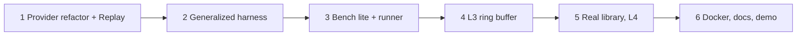

# Ferrite Next Stage: Offline-First Bench Lite and Demo

## Goal Description
Phase 0-1 is done (vertical slice on `clamp`). This stage makes Ferrite demo-ready and resume-ready **without LLM API keys**, while keeping a clean path to real models later.

Approach: translations come from a **ReplayProvider** that serves hand-written reference Rust from fixtures. An **OpenAI-compatible HTTP provider** sits behind the same `LlmProvider` trait and is activated by env vars (`FERRITE_PROVIDER=openai`, `FERRITE_API_BASE`, `FERRITE_API_KEY`, `FERRITE_MODEL`). The verification engine, which is the real product, runs for real.

> [!IMPORTANT]
> Replay translations are human-written, not model output. Every doc, dashboard and video must say "replay mode", and must not claim LLM results. This matches the project's "do not oversell" rule.

## User Review Required
- Scope was chosen as: **Bench lite (~30 functions, 3 tiers, 3-5 planted bugs) + 1 small real library**, with L3 as a ring-buffer demo only.
- Deferred: multi-model sweeps, predictive router, L5, idiom memory, lifter.
- Verification runs in **Docker only** (Linux image with clang, ASan, rustc).

## Open Questions
> [!NOTE]
> Which small real library do you prefer? Default: a CRC32/Adler checksum subset (pure, permissive license), then an INI parser if time allows.

## Proposed Changes

### Provider layer (`src/provider.rs`)
#### [MODIFY] provider.rs
- Extend the trait: `complete(&self, req: &CompletionRequest) -> Result<Completion>` where `Completion { text, tokens, cost_usd, latency_ms }`. Keep a `complete(prompt)` shim so existing tests still pass.
- Add `ReplayProvider`: loads `fixtures/replay/<fn_name>.rs.md`. A missing file gives a clear error.
- Add `OpenAiCompatProvider` (using `ureq` with a blocking client): POST `{base}/chat/completions`, retries, timeout, budget cap. It is compiled behind a cargo feature `llm-http` so the default build stays dependency-light.
- Add `provider_from_env()` factory; `main.rs` gets `--provider replay|mock|openai`.

### Benchmark (`bench/`)
#### [NEW] bench/tier1/*.c, bench/tier2/*.c, bench/tier3/*.c
- Tier 1: scalar and string utilities (about 12). Tier 2: buffers and small parsers (about 10). Tier 3: ring buffer, stack and small stateful APIs (about 5).
- Planted-bug set: off-by-one read, signed overflow, and an OOB write in C. Each has a safe Rust replay translation, which should yield `C_LATENT_BUG`.
#### [NEW] bench/manifest.toml
Lists each function, tier, expected verdict and library, split by library.
#### [NEW] fixtures/replay/
One reference translation per bench function.

### Verification and runner
#### [MODIFY] verify.rs and harness gen
- Generalize the harness beyond the `(i32,i32,i32)` seeds: derive seeds from `FeatureVector` and signature (scalars, `&[u8]` plus length, NUL strings).
- Ensure triage produces `Equivalent`, `Diverged` and `CLatentBug` for real.
#### [NEW] src/bench.rs and `ferrite bench` subcommand
Runs the manifest, compares actual verdicts with expected ones, and emits `bench-results.json` and a leaderboard table (compile rate, L-level distribution, latent bugs found).
#### [NEW] docker/Dockerfile and `scripts/ferrite-docker.ps1`
Linux image with clang, rustc, cargo. The runner mounts the repo and runs `cargo test` and `ferrite bench` inside it (no network).

### L3 demo
#### [NEW] src/verify/stateful.rs
Sequence fuzzing for an opaque ring-buffer handle: a random op list (push/pop/len) is applied to the C and Rust versions, comparing state after each op. Marks L3.

### Real library
#### [NEW] bench/lib_checksum/ with `ferrite.toml`
Migrate it function by function, build a hybrid with source shims (ADR 0005), and run its original tests for L4.

### Docs and demo
#### [MODIFY] README.md, docs/
Add a results table, a "replay vs live model" section, and `.env.example` for LLM keys.
#### [NEW] docs/DEMO.md
A 3-5 minute video script: a clean migration, a diverged-then-repaired case (replay supplies a bad first answer and then a fixed one), and a latent-bug finding.
#### [NEW] docs/adr/0011-replay-provider-and-offline-first.md

## Phases

## Verification Plan
### Automated Tests
- `cargo fmt --check`, `cargo clippy --all-targets -- -D warnings`, `cargo test`
- Provider unit tests (replay hit/miss, env factory), and an `OpenAiCompatProvider` test against a local mock HTTP server
- `ferrite bench` inside Docker: all expected verdicts must match the manifest
### Manual Verification
- Run the demo script end to end and open `dashboard.html`.
- Set a real key later, run one function with `--provider openai`, and confirm the pipeline is unchanged.
